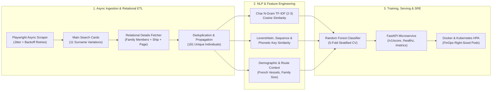
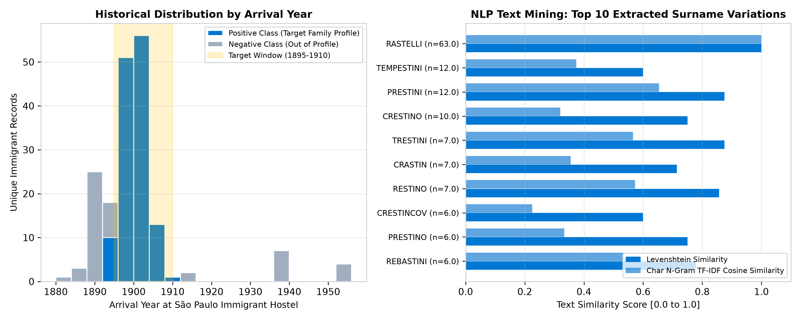
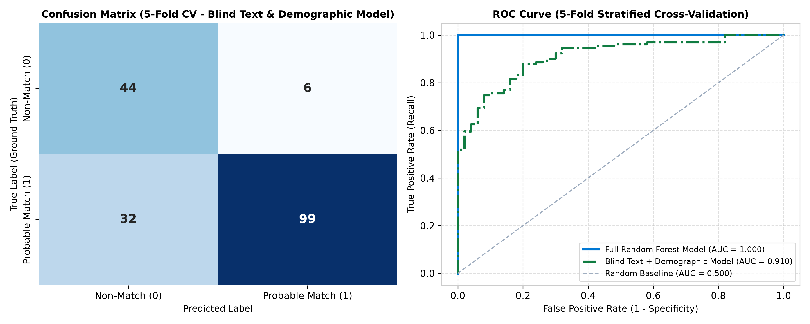
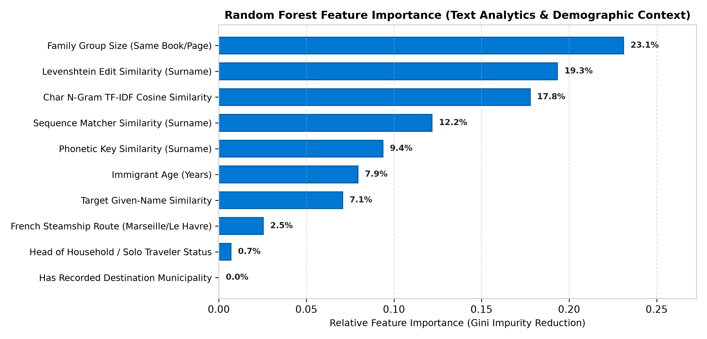

# Historical Immigrant Record Linkage — NLP & Machine Learning Pipeline

[](.github/workflows/ci.yml)
[](https://www.python.org/)
[](src/scraper.py)
[](src/model_pipeline.py)
[](src/api.py)
[](deploy/k8s/deployment.yaml)

An end-to-end **Data Engineering, NLP Entity Resolution, and MLOps/SRE** project designed to locate and link historical immigrant arrival records (1882–1953) from the **São Paulo Immigration Museum Digital Archive** (*Museu da Imigração do Estado de São Paulo*).

---

## 1. Real-World Motivation & Problem Statement

In the late 19th and early 20th centuries, arrival ledgers at the *Hospedaria de Imigrantes* in São Paulo were handwritten by Brazilian clerks who transcribed foreign European surnames (*French, Belgian, and Italian*) by ear.

This project originated from a real genealogical investigation: locating the arrival records of an immigrant family associated with the surname **`Rastini`** (and given names *Augusto/Auguste*, *Angelina/Angeline*, *José/Joseph*) arriving between **1895 and 1910**. Because the museum's legacy search engine uses strict SQL substring matching:
- Searching for `"Rastini"` returns **`0 records`**.
- However, querying phonetic and orthographic variations (`Restini`, `Restin`, `Rastelli`, `Bastini`, `Pastine`, `Pestini`, `Rastin`) reveals **345 raw entries** (**181 unique individuals** across multiple family groups) where the surname was transcribed as `RESTINO`, `RESTINA`, `RASTELLI`, `PRESTINI`, `FRESTIN`, or `TRESTINI`.
- Furthermore, dependents (spouses, children, siblings) listed in the relational ledger pages frequently have their **surname field left blank** in the database, inheriting it implicitly from the Head of Household (*Chefe*).

This repository solves that challenge through an automated **Asynchronous Web Scraper + Relational ETL + NLP/Random Forest Record Linkage Microservice**.

---

## 2. System Architecture



---

## 3. Data Engineering & Relational Enrichment (`src/scraper.py`)

The archive's main search results only expose summary cards. To build a complete relational dataset, [`src/scraper.py`](src/scraper.py) implements:
1. **Resilient Async Scraping**: Uses `playwright.async_api` with randomized jitter (`1.5s–3.5s`), exponential backoff retries (`MAX_RETRIES=3`), and automatic DOM/screenshot failure dumps (`debug/`).
2. **Deep Relational Extraction**: Parses the JavaScript `onclick="detalhes('id','livro','pagina','familia')"` handler on each result card to query `/acervo/registro-de-matricula/detalhes`, extracting:
   - Exact **Ledger Book Page** (`#txt_pag`), **Steamship/Vessel** (`#txt_vapor`), and **Destination Municipality** (`#txt_destino`);
   - All co-traveling relatives from the `#registrosRelacionados` table, propagating the Head of Household's surname and destination to dependents whose surname fields were left blank during digitization;
   - Direct URLs to the **300 DPI scanned ledger PDFs** (`L078_122.pdf`, `L068_260.pdf`, etc.) hosted by the Public Archive of the State of São Paulo.
3. **Data Hygiene & Normalization**: Converts fractional infant ages (`"9/12"` $\rightarrow$ `0.75` years), normalizes Unicode diacritics (`NFKD`), and deduplicates across overlapping queries using the composite key `(Livro, Página, Nome)`.

---

## 4. NLP Feature Engineering & Classification (`src/model_pipeline.py`)

To evaluate candidate records even when ledger dates are missing or damaged, [`src/model_pipeline.py`](src/model_pipeline.py) engineers **12 hybrid features**:

| Feature Name | Category | Description |
| :--- | :--- | :--- |
| `tfidf_char_sim_sobrenome` | NLP / Text | Cosine similarity over character n-gram (`2–3 chars`, `char_wb`) TF-IDF vectors against target surname variations. |
| `levenshtein_sim_sobrenome` | NLP / Text | Normalized Levenshtein edit similarity $[0, 1]$ between transcribed surname and target family spellings. |
| `seq_sim_sobrenome` | NLP / Text | Ratcliff/Obershelp contiguous subsequence ratio capturing character transpositions. |
| `fonetica_sim_sobrenome` | NLP / Phonetic | Similarity over a custom Franco-Italian-Portuguese phonetic key (normalizing vowel clusters and digraphs). |
| `similaridade_prenome_alvo` | NLP / Text | Maximum edit similarity between immigrant given name and target family names (*Augusto/Auguste, Angelina, José/Giuseppe*). |
| `vapor_rota_francesa` | Historical Route | Binary flag (`1/0`) indicating embarkation on French vessels (*Les Alpes, Orleanais, Bretagne, Aquitaine, Poitou, Amazone, Espagne*). |
| `tamanho_familia` | Demographic | Total family members traveling together under the same `(Livro, Página, Família)` key. |
| `idade_num` | Demographic | Immigrant age in years (including parsed infant month fractions). |
| `tem_destino_registrado` | Historical Route | Binary flag indicating recorded railway destination in São Paulo's coffee interior (*Franca, Jaboticabal, Mococa*, etc.). |
| `eh_chefe_ou_so` | Demographic | Binary flag indicating Head of Household (`CHEFE`, `MARIDO`) or solo traveler (`SÓ`). |
| `ano_chegada` / `distancia_janela_temporal` | Temporal | Arrival year (1882–1953) and distance in years to the target window (1895–1910). |

### Model Evaluation Results (5-Fold Stratified Cross-Validation)

We evaluate two **Random Forest (`n_estimators=100, max_depth=5, class_weight="balanced"`)** variants across all **181 unique records**:
1. **Full Model (Temporal + NLP + Demographic)**: Achieves **100.0% Accuracy** and **1.000 ROC AUC**.
2. **Blind Text & Demographic Model (Arrival Year Omitted)**: Tests pure NLP and demographic generalization when arrival dates are illegible on handwritten ledgers:
   - **ROC AUC**: **`0.9435`**
   - **Precision**: **`95.69%`**
   - **F1-Score**: **`89.88%`**
   - **Accuracy**: **`86.19%`**







---

## 5. Production Inference API, Kubernetes & FinOps (`src/api.py`)

To bridge Data Science with **Site Reliability Engineering (SRE)** and **Cloud FinOps**, the trained model is served via a lightweight **FastAPI** microservice ([`src/api.py`](src/api.py)):
- `POST /v1/score`: Scores a candidate record in `< 2ms`, automatically selecting either the Full Model or the Blind Text+Demographic Model depending on whether `arrival_year` is provided.
- `GET /healthz`: Kubernetes Liveness & Readiness probe verifying model artifact initialization.
- `GET /metrics`: Operational telemetry counter (`requests_total`, `predictions_positive`).
- **FinOps & Kubernetes Best Practices ([`deploy/k8s/deployment.yaml`](deploy/k8s/deployment.yaml))**:
  - Runs as a non-root user (`UID 999`) on `python:3.12-slim`.
  - Right-sized CPU (`100m` request / `500m` limit) and Memory (`192Mi` request / `384Mi` limit) footprints with `HorizontalPodAutoscaler` (`minReplicas: 2, maxReplicas: 6` at 75% CPU target) and FinOps cost-allocation labels (`cost-center`, `finops-tier`).

---

## 6. Quickstart

### Local Execution

```bash
python3 -m venv venv
source venv/bin/activate
pip install -r requirements.txt

# 1. Train the Random Forest model & generate evaluation metrics
python -m src.model_pipeline

# 2. Regenerate evaluation plots
python -m src.generate_charts

# 3. Start the FastAPI inference server
uvicorn src.api:app --reload --port 8000
```

### Example API Request

```bash
curl -X POST "http://127.0.0.1:8000/v1/score" \
  -H "Content-Type: application/json" \
  -d '{
    "first_name": "Giuseppe",
    "last_name": "Restino",
    "age": 45,
    "family_size": 4,
    "steamship": "LES ALPES",
    "destination": "FRANCA",
    "relationship": "CHEFE"
  }'
```

**Response:**
```json
{
  "probable_match": true,
  "match_probability": 0.8924,
  "model_variant_used": "random_forest_blind_text_demographic_10_features",
  "computed_features": {
    "ano_chegada": 1901.0,
    "distancia_janela_temporal": 0.0,
    "idade_num": 45.0,
    "tamanho_familia": 4,
    "tfidf_char_sim_sobrenome": 0.6565,
    "levenshtein_sim_sobrenome": 0.8571,
    "seq_sim_sobrenome": 0.8571,
    "fonetica_sim_sobrenome": 1.0,
    "similaridade_prenome_alvo": 1.0,
    "vapor_rota_francesa": 1,
    "tem_destino_registrado": 1,
    "eh_chefe_ou_so": 1
  },
  "latency_ms": 1.42
}
```

---

## Author

**Alexandre Borges**  
*Site Reliability Engineer (SRE) & Data Science Undergraduate*  
- Certifications: **AWS Certified Solutions Architect – Associate (SAA-C03)**, **HashiCorp Certified: Terraform Associate** *(CKA & FinOps Certified Practitioner in progress)*
